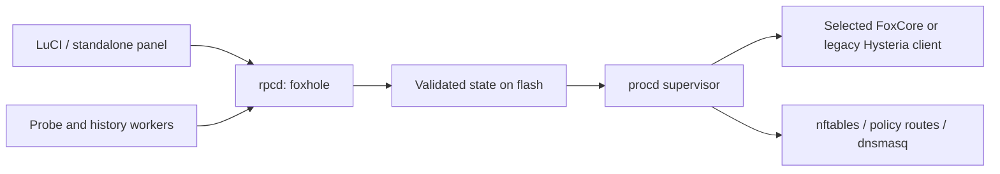
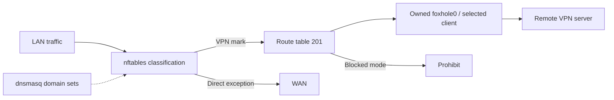

# Architecture

The control plane uses LuCI, rpcd and ucode. A Core profile selects the installed
FoxCore outbound client; legacy profiles retain the separate Go Hysteria path.
Incoming HY2 uses that separate Go server and the owned Core compatibility bridge.
Country rules currently use the existing IP-prefix feed; signed FoxHole DB
integration is a separate contract.

## Control plane

RPC validates input and state revisions, then replaces state under a private lock.
For a legacy profile the supervisor starts Hysteria, waits for `foxhole0` and a successful HTTPS
probe through Hysteria's local HTTP proxy, applies policy, and reports
`connected`. Exit removes the runtime credential file and applies the
configured block/off policy. This probe does not establish LAN acceptance.

## Traffic paths

Reserved networks bypass classification. Device-direct rules precede
scoped site/country rules; site-VPN precedes site-direct, then country-direct.
Remaining scoped traffic uses VPN. The egress guard drops VPN-marked
packets that would leave outside the TUN.

Legacy incoming users use a separate Hysteria ACL: permitted LAN ranges, private
range rejection, then country exceptions/upstream when client rules and VPN
are active; otherwise direct egress. Shared UDP/443 permits 32 users with
one LAN policy; separate listeners permit four users with individual ports.

Country prefixes come from `ipverse/country-ip-blocks`; IP probes use
Cloudflare trace. Profiles and authentication are stored under
`/etc/foxhole`; runtime files and history use `/tmp/foxhole`. Thirty-day
history is checkpointed hourly to flash.

Phone pairing uses the changed panel PIN to authorize `pair.create`. The
phone generates and keeps an independent random 256-bit credential; the
router stores only its SHA-256 verifier in `/etc/foxhole/pairing.json`, with
at most 16 devices. The phone must retain the same ID/key while retrying an
interrupted pairing. `pair.unlock` exchanges it for a short panel session;
revocation fences that session immediately, including after ID reuse.
Paired sessions cannot create other pairings or change the panel PIN; PIN
change/recovery clears all pairings. The standalone gateway requires HTTPS
for `pair.*` and every subsequent request using the `p1.` phone session;
removing that prefix cannot identify an issued session. Pairing actions
are not exposed to the LuCI iframe bridge.
The phone service has its own document root and listens only on the live
private IPv4 LAN address at port 8443. An input filter refuses that port
from other interfaces. Its persistent public leaf is
`/etc/foxhole/mobile.crt`; the root-only private key is never an API field.
The phone pins the reviewed leaf before sending a PIN. A changed or expired
identity is not silently regenerated. Firmware service acceptance remains
a separate gate.

Paired inbound client exports include separate bounded app metadata.
URI/config/QR bytes remain protocol-compatible; provider and web exports
are unmarked. Apps establish origin from the authenticated paired reply,
never marker text alone. See [profile origin](PROFILE-ORIGIN.md).

`phone.provision` accepts only a paired session and the HTTP peer address.
It resolves the phone's current LAN MAC, journals the pairing-owned intent,
then publishes state. A lost reply retries the same LAN device and optional
HY2 inbound credentials. Remote generation requires the existing configured
server template and never exports the upstream profile as a router client.
The return value keeps `remoteReady` false until public reachability is
separately verified. The management service is never opened to WAN.

`phone.status` admits a Core proof only with the live process/TUN generation,
matching current routing state, an actual normal-mark kernel TUN route,
protected IPv6 policy and normalized installed nftables chains. A VPN-bound
HTTPS probe must be no older than five seconds measured by router uptime.
Short caches remain tied to process/TUN and policy identity; changing state,
generation or losing the TUN invalidates them. The Android capability stays
off until actual firmware acceptance. Legacy telemetry is not this proof.

Core profiles use `server.save` with `engine: core`. The installed CLI admits
one URI or EngineConfig through root-only files; its compiled features decide
whether the selected protocol is available. Legacy Hysteria remains a separate
path for unchanged Gecko, BBR and other options. Core is an outbound client;
the existing HY2 server still owns remote client access.

Bootstrap drops normal-marked output even when a socket is bound to the TUN;
the policy-table prohibit alone does not block that kernel path. Upstream and
the separate proof mark remain available. The controller removes this block
only after a fresh proof for the same generation and configuration, then
checks the actual installed routing policy. Before publishing connected,
the runtime performs another authenticated probe, invalidates the short
owner and kernel caches at that probe boundary, and rechecks the live owner,
generation, state, configuration and kernel policy. Proof freshness is checked
last against router uptime. A changed identity or stale proof fails closed.
Unexpected Core loss reapplies the block; an explicit Stop remains separate
from that failure path.

Private subscription metadata retains source URL, selected protocol/node,
option ID and phone profile ID. It is returned only by authenticated
`server.get`, never public state. The source is retained for future refresh;
initial synchronization sends the user's exact selected configuration.
`configSha256` identifies normalized admitted configuration for interrupted
save recovery without matching a name or choosing another node.

## Source references

| Contract | Implementation |
| --- | --- |
| State, authentication, RPC | [foxhole.uc](../package/foxhole-openwrt-client/root/usr/share/rpcd/ucode/foxhole.uc) |
| Phone credential admission and revocation | [pairing.uc](../package/foxhole-openwrt-client/root/usr/share/foxhole/pairing.uc) |
| Phone LAN binding and idempotent provisioning | [mobile.uc](../package/foxhole-openwrt-client/root/usr/share/foxhole/mobile.uc), [mobile service](../package/foxhole-openwrt-client/root/etc/init.d/foxhole-mobile) |
| Start, probe, exit | [supervisor](../package/foxhole-openwrt-client/root/usr/libexec/foxhole-supervisor), [runtime](../package/foxhole-openwrt-client/root/usr/libexec/foxhole-runtime) |
| Routing precedence | [runtime-model.uc](../package/foxhole-openwrt-client/root/usr/share/foxhole/runtime-model.uc) |
| Incoming users | [inbound.uc](../package/foxhole-openwrt-client/root/usr/share/foxhole/inbound.uc) |
| Sampling and retention | [probe](../package/foxhole-openwrt-client/root/usr/libexec/foxhole-probe), [history.uc](../package/foxhole-openwrt-client/root/usr/share/foxhole/history.uc) |

Known limits: DNS classification is approximate; incoming-user direct
fallback is independent of the LAN kill switch; device/load acceptance
remains a [release gate](RELEASE.md).

## Phone routing leases and remote access

`phone.handoff` scopes a short kernel lease to an authenticated registered phone,
its MAC, claim and exact provider IP/transport/port tuples. Boot ID, credential
verifier, replacement fences and release tombstones reject stale commands. The
fresh actual NFT readback is exposed as `phone.status.handoff`; unknown state
omits the field instead of claiming absence. Authenticated router monotonic
request timestamps and CGI queue residence are bounded to five seconds. Ordinary traffic
retains router routing rules. `router_vpn` release requires matching fresh owned
Core generation and proof before and after removing the lease. `phone.resolve`
returns bounded public provider addresses over authenticated LAN HTTPS with a
fixed TLS-verified WAN resolver. Home capability flags remain false pending real
firmware and packet acceptance.

Compact bootstrap installs the incoming Hysteria server only with explicit
`--server`; the default installs client modules. Remote client creation uses
that separate server package. On an
actual public IPv4 WAN, explicit creation can initialize a separate P-256 TLS
identity and pinned client profile; the existing identity is never replaced.
Created configuration does not establish outside UDP reachability. Selected
client payloads and the optional server, their native producers, legal files
and working memory enter the complete RAM budget before installation. The installer
stages verified binaries before post-install services run.

The separate Hysteria binary uses Go 1.26.10 and a pinned x/net 0.60 dependency
repair. Its producer retains the original upstream archive identity, marks the
source as modified, and binds the exact patch and effective source hashes.
SDK builds and package budgets reject the old toolchain or missing repair
evidence. The historical ARM-only `hysteria-ram` download is outside this Core
catalog and has no current security qualification.

Native legal metadata retains separate source identities. Schema 1 binds an
upstream source archive; schema 2 binds source content and its exact manifest,
with signed commit, tree and source-bank references. The SDK verifies those
references against the actual producer before packaging. The installed router
registry verifies the same schema identities and exact legal file set before
accepting a slot; it retains archive based validation for schema 1. Its format
checks do not replace source signature verification by the SDK.

Compiler qualification and source tests have separate identities. The producer
records retained exact-source Go 1.26.9 tests in `sourceTestScope`, and the
verified Go 1.26.10 toolchain and ordinary TLS control in
`currentCompilerQualification`. Neither field establishes current target
runtime, authenticated traffic or memory acceptance. FLASH and RAM package
revisions advance to `2.12.2-r5` and `2.12.2-r4` for the changed native bytes.

For compact schema 2, `tools/compact-install-bundle.py` prepares or verifies the
complete module catalog, signed APKs and native dependency closures. The legacy
schema 1 path uses `tools/prepare-install-bundle.py` and
`tools/verify-install-bundle.py`. Both paths bind every asset to the manifest
anchor and reject provisional laboratory memory policies. Preparing a bundle
does not publish or establish firmware acceptance.

Core package authentication retains the original signed OpenWrt indexes.
FoxHole APKs and their index use the canonical FoxHole key; upstream indexes
use the original firmware keys. Upstream APKs need not carry individual
signatures. Native APK verifies their identities against the original signed
entries by fetching the complete offline closure into a new empty directory.
Existing destinations and `--link` are excluded from this verification.
Whole-archive hashes bind release assets separately from signed package identities.
Installation uses exact indexed roots after live dependency/kernel checks;
the installer never installs a kernel or replaces an existing trust identity.
Index/key assets and verification copies are included in staging budgets.
Before publishing the installed receipt, the installer reads the actual owned
Core/server producers, binary or RAM-cache hashes and native capabilities.
Retaining a different same-version binary is an error, not successful setup.
Current source implements this contract; complete native chain and firmware
acceptance remain separate gates.

Incoming client deletion is linearized under the state lock: procd cancels the
owned listener and the captured process/start identity must be gone before state
removal returns `clientRevocation.applied=true,targetRevoked=true`. Failure is an
error and preserves the client record. The publication loop acquires the same
state lock and refuses stale snapshots. An owner-journal tombstone prevents an
old provision retry restoring the deleted client. Legacy shared-profile deletion
returns `targetRevoked=false`; external provider credentials are not revoked.
Management unpair and incoming VPN client deletion remain separate actions.
Source checks cover these contracts; live procd/old-auth acceptance is pending.

## Software updates

The authenticated `updates.*` contract uses a separate durable journal and
policy, serialized with engine mutations by `engine.lock`. See
[Software updates](UPDATES.md) for trust, scope and recovery rules.

### Native command capture generation

Native package-file writes do not inherit a capture file-size limit. The v2
command helper sends stdout and stderr through separate byte-counted FIFO sinks.
Each sink retains its call-specific bound, up to 8 MiB; even one overflow byte
fails the capture. Native arguments and package verification remain unchanged.

The registry caches the v2 helper and utility bytes before its first native call
and stages that generation in a private directory for each command. A live
worker therefore retains its code during BASE replacement or rollback. The
original command helper remains unchanged for already running older workers.
The native deadline is unchanged; five additional seconds belong only to owned
process and FIFO cleanup before the outer command deadline.

Owned child waits poll the recorded PID and process start before calling the
shell wait builtin for an exited child. This preserves its exit status when
SIGCHLD is blocked; unknown process generations fail closed. The native
deadline and cancellation ownership checks remain unchanged.

Recovery reconciliation rereads terminal state under the engine lock before
writing recovery state, preserving an already completed transaction.

Capture readiness observes the initial process before its registration marker.
A validated native registration may already be complete: its recorded process
generation must match, or its absence must be confirmed. The existing poll and
shell wait still determine the actual native exit status. Stream drainers and
the timer must remain live; owner, timeout and cancellation checks stay strict.

## First-setup agreement

The [versioned agreement](../package/foxhole-openwrt-client/root/usr/share/foxhole/license-agreement.json) is shown by the CLI, web panel and both Android clients. Fresh setup requires an unchecked-by-default choice. Phone host-key discovery remains read-only; authenticated SSH setup requires the explicit choice, which adds `--accept-license` to the installer command. `install.sh --license` displays the agreement without staging an installation.

First-PIN RPC requests carry a plain Boolean `licenseAccepted` and integer `licenseVersion`. The current contract requires `true` and `1` before any authentication-record write. The web panel displays that version before enabling Save. Successful CLI installation records the same explicit choice in private `/etc/foxhole/license.json`; first-PIN setup can retain it. Corrupt records fail admission. Existing configured routers keep their recorded state without an invented retrospective acceptance.

Agreement and update policy are separate choices. A fresh phone Setup starts with automatic FoxHole package updates selected, provides an opt-out and writes the policy only after installation and pairing. Existing pairing does not overwrite the policy. Direct CLI/backend defaults remain off, and later changes use Settings. The daily updater preserves selected modules, profiles and pairing; firmware and bulk system-package upgrades are outside this transaction.

## Native transaction utility delivery

The BASE remains an architecture-independent data package. It carries the two normal compressed transaction executables and a closed ABI 1 manifest, while the loader selects only `x86_64` or `aarch64_cortex-a53`. The manifest contains ELF/gzip hashes and sizes plus the clean fork source identity; it supplies no executable paths. The package declares `+libgcc` because the actual ELF closure needs `libgcc_s.so.1` and musl `libc.so`.

The [BASE Makefile](../package/foxhole-openwrt-client/Makefile) requires an explicit external manifest, its actual SHA-256, and both normal gzip inputs. The [typed artifact verifier](../tools/check-transaction-inputs.py) validates both complete targets, bounded decompression, ELF architecture/interpreter, normal applets and the two-library closure. It writes only verified bytes at the fixed three package data names. Missing data never triggers an unverified source-build fallback.

Only the clean fork source archive is tracked under [native/transaction](../native/transaction/README.md). The public exporter still refuses filesystem links and arbitrary binary/archive paths. A dedicated source-role verifier admits the exact source archive containing 416 regular files and the one original source link `src/apk-static.c` to `apk.c`; that exception does not apply to runtime ELF/gzip inputs.

The standalone utility is GPL-2.0-only, with Mbed TLS and its framework selected under their GPL-2.0-or-later version 2 option and original Zlib notices retained. Complete corresponding-source inputs accompany the release separately as `foxhole-apk-transaction-v1-source-inputs.tar.gz`, identified by its actual hash in the [source/build record](../native/transaction/SOURCE.json). Original small notices and the source-offer reference are installed in BASE; the 7.63 MB source-input asset is not stored on router flash. The public source delivery also retains the final SDK build, verification and package installation scripts.

The [recorded rebuild recipe](../native/transaction/README.md) uses the exact SDK/source inputs, normal release flags, stripping and deterministic compression. Static input/build verification is separate from actual native root/layout, rollback, resource and tunneled-traffic acceptance for the distributed artifacts.
