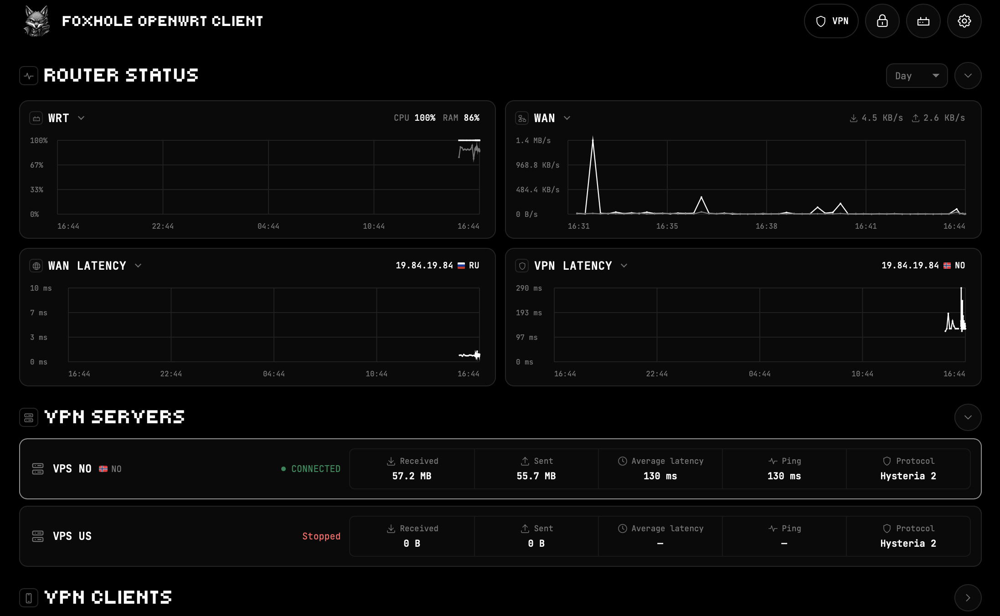

<p align="center">
    
</p>

<div align="center">

[](../README.md)
[](README.ru.md)
[](README.de.md)
[](README.fr.md)
[](README.es.md)
[](README.ja.md)
[](README.zh.md)

</div>

<p align="center">
  <a href="https://github.com/foxhole-team/foxhole-openwrt-client/releases">
    
  </a>
</p>

# FoxHole OpenWrt

Profils VPN, règles de routage et interface simple pour les routeurs OpenWrt.
Les connexions VPN sortantes utilisent [FoxCore](https://github.com/foxhole-team/foxhole-core).
Les installations compactes utilisent un module client distinct pour chaque
protocole sélectionné. Un serveur Hysteria facultatif accepte les connexions de vos appareils.

<p align="center">
  
</p>

## 🔌 Protocoles VPN pris en charge

Modules VPN FoxHole actuellement disponibles pour le routeur :

| Protocole | Option d’installation |
| --- | --- |
| VLESS | `--vless` |
| Hysteria2 | `--hy2` |
| WireGuard | `--wg` |

## 📋 Prérequis

- OpenWrt 25.12.5 avec APK, un accès root et une connexion Internet.
- Des paquets publiés pour le micrologiciel, la cible, l’architecture et les protocoles exacts. La politique actuelle des paquets et mises à jour admet `x86/64` et `mediatek/filogic` ; une compilation SDK ou un nom d’architecture ARM ne valide pas tous les modèles de routeur.
- Assez de mémoire flash et de RAM pour le budget complet et vérifié des paquets. Avant toute modification, l’installateur contrôle les dépendances, l’ABI du noyau et l’espace temporaire.
- Un accès depuis un LAN de confiance. Activez d’abord le Wi-Fi s’il est désactivé sur un routeur neuf.

Dans cette bêta publique, les modules VPN sortants utilisent FoxHole Core 1.0.1. La prise en charge dans les sources et un binaire compilé pour une autre
architecture ne suffisent pas à établir la compatibilité du routeur. Seuls les
paquets figurant dans un catalogue de publication authentifié peuvent être installés.
Le serveur entrant conserve deux constats examinés concernant des dépendances
S2/OpenPGP inutilisées ; les vérifications du build exact et l’échéance des exceptions sont documentées dans [Publication](RELEASE.md).

## 📦 Installation

Utilisez une étiquette de version publiée et examinée, ainsi que le SHA-256 de son
fichier `SHA256SUMS`, authentifié par un moyen indépendant. Cette commande vérifie l’installateur avant son exécution :

```sh
(set -eu; url='https://github.com/foxhole-team/foxhole-openwrt-client/releases/download/RELEASE_TAG'; f=$(mktemp /tmp/foxhole-install.XXXXXX); trap 'rm -f "$f"' EXIT; uclient-fetch -q -T 60 -O "$f" "$url/install.sh"; printf '%s  %s\n' 'fb0a2bad91a1eebd3591801f79dd6b83fc70bf94ddc1b8d6577f94519de1d1d9' "$f" | sha256sum -c -; sh "$f" --base-url "$url" --manifest-sha256 MANIFEST_SHA256 --apply)
```

Avec `--apply`, l’installateur interactif affiche l’accord et demande `[y/N]`, avec Non par défaut. Consultez-le avec `sh install.sh --license`. L’installation non interactive exige `--accept-license` après acceptation explicite. Dans l’assistant du téléphone, le choix distinct de consentement est initialement décoché.

Pour les catalogues compacts, la valeur par défaut est **le client Hysteria2
uniquement**, stocké en mémoire flash. Avec un lot de publication local vérifié, choisissez un protocole ou combinez les options :

```sh
sh install.sh --bundle /tmp/bundle --manifest-sha256 HASH --hy2 --flash --apply
sh install.sh --bundle /tmp/bundle --manifest-sha256 HASH --vless --wg --flash --apply
sh install.sh --bundle /tmp/bundle --manifest-sha256 HASH --hy2 --server --ram --apply
```

`-wg` est un alias de `--wg`. Autres options reconnues : `--vmess`, `--tuic`,
`--trojan`, `--shadowsocks`, `--naive`, `--anytls`, `--shadowtls`, `--socks`, `--http`.
Les catalogues compacts combinent les modules publiés dans un mode de stockage
commun. Chaque module sélectionné doit être disponible pour votre micrologiciel
et votre cible. `--all` demande tous les protocoles reconnus et est refusé si un
module manque. Les anciens catalogues schema 1 exigent une variante précise unique.

| Stockage | Comportement |
| --- | --- |
| `--flash` | Le moteur reste en mémoire flash après un redémarrage. Mode par défaut. |
| `--ram` | Le moteur utilise la RAM et télécharge son binaire épinglé après un redémarrage. Les paramètres restent en mémoire flash. |
| `--auto` | Choisit la mémoire flash si le budget complet tient, sinon un ensemble de modules RAM disponible. |

Retirez `--apply` pour vérifier le lot sélectionné sans l’installer. Les paquets
du noyau ne sont jamais mis à niveau pour rendre compatible un lot qui ne l’est pas.
Pour les catalogues compacts, `--server` ajoute le serveur Hysteria entrant au
budget de ressources. Il reste désactivé jusqu’à la configuration de l’accès distant.

## 🔗 Utilisation et appairage

Ouvrez **LuCI → Services → FoxHole**, choisissez un PIN et ajoutez un profil VPN.
Les règles peuvent diriger le trafic des appareils, domaines et pays vers le VPN ou une connexion directe.

`ACCESS_LOCAL_NETWORK` - recherche, configuration et gestion des routeurs. Sous Android 17 (API 37) ou ultérieur, si l’application cible l’API 37 ou ultérieure, elle demande l’autorisation système avant les actions LAN. Un refus bloque ces actions.

La configuration du téléphone cherche le routeur à la passerelle IPv4 privée du Wi-Fi
connecté ; une adresse peut aussi être saisie manuellement. Avant l’appairage, le téléphone
vérifie l’identité SSH et l’identité TLS privée du routeur sur le LAN. Un PIN
existant est conservé. L’adresse de gestion reste privée.
Le désappairage retire l’accès d’administration. Supprimez séparément le client
distant pour révoquer ses identifiants VPN. La suppression d’un ancien profil
partagé retire uniquement son enregistrement ; elle ne peut pas révoquer les identifiants détenus par un fournisseur VPN externe.

L’accès distant nécessite le serveur Hysteria sélectionné avec `--server`. Sur un
routeur disposant d’une adresse WAN publique, **Créer un profil VPN** ajoute un
client distant. Sélectionner un client ouvre son profil existant.
Le point d’écoute UDP doit également être accessible depuis l’extérieur du réseau domestique.
Le basculement VPN automatique sur le réseau domestique reste désactivé jusqu’à
la validation réelle du routage, y compris les contrôles de fermeture en cas d’échec et de propriété du tunnel.

Dans les applications Android :

L’icône Wi-Fi indique uniquement une connexion Wi-Fi physique, sans SSID ni accès à la localisation. La recherche et toute nouvelle configuration/association exigent le Wi-Fi. L’adresse manuelle est préremplie une fois avec la passerelle IPv4 privée du Wi-Fi actuel, si disponible, et reste modifiable.

Gérer via le VPN domestique est un choix distinct, DÉSACTIVÉ par défaut pour chaque association existante. Il exige aussi votre confirmation Adresse IP publique (le routeur possède une IP publique et un service VPN entrant) et une route VPN active utilisable. Cette confirmation n’attribue aucune adresse et ne configure pas le pare-feu. L’application peut tenter la gestion à l’adresse privée enregistrée via ce réseau VPN avec l’identité TLS épinglée et l’authentification associée existantes ; elle n’ouvre aucun port de gestion WAN et ne permet pas de nouvelle recherche/association via le réseau mobile.

Seuls les profils VPN entrants transmis directement à l’application par un routeur associé et authentifié reçoivent des métadonnées distinctes de liaison avec l’application. URI de connexion, configuration et formats QR restent inchangés. Les exports génériques web/QR/fournisseurs restent sans marque ; des indications importées ne créent pas de confiance à elles seules.

La reconnaissance automatique exige aussi le profil local enregistré correspondant, sa configuration actuelle et l’association sélectionnée, avec ce profil réellement connecté via le VPN de l’application. Une vérification bornée est effectuée par connexion réelle, sans minuteur, nouvelle tentative automatique ni interrogation des profils fournisseurs. Réessayer l’association est une procédure explicite Wi-Fi/autorisation/PIN : l’ancien enregistrement est conservé jusqu’à l’authentification réussie, sans accepter silencieusement une identité de certificat différente.

## 🧩 Ajouter un protocole ultérieurement

Dans **VPN du routeur → Protocoles**, sélectionnez un protocole disponible et
confirmez son installation. Les mêmes commandes sont accessibles dans l’application
Android appairée. Chaque protocole utilise son propre paquet moteur compact et
signé ; aucun remplacement silencieux par un moteur universel plus volumineux n’a lieu.

L’ajout d’un protocole inutilisé laisse le VPN actuel fonctionner. La mise à jour
du protocole actif demande une reconnexion. Cessez d’utiliser un protocole avant
de le supprimer. Seuls les paquets publiés pour la cible exacte de votre routeur sont proposés.

## ♻️ Mise à jour et suppression

### 📥 Mises à jour des paquets FoxHole

Dans **Paramètres → Mise à jour FoxHole** de l’interface web ou de l’application associée, la recherche et l’installation utilisent la même transaction authentifiée. Elle met à jour le panneau/runtime FoxHole et les modules de protocoles clients installés et sélectionnés, en conservant leur mode FLASH/RAM. Les nouveaux protocoles sont installés séparément. Profils et association sont conservés ; ni le micrologiciel OpenWrt ni les autres paquets système ne sont mis à jour.

Les installations directes par CLI/backend laissent les mises à jour automatiques désactivées par défaut. Lors d’une nouvelle configuration depuis le téléphone, la case distincte et visible est cochée ; décochez-la pour refuser. La politique est enregistrée après installation et association. Associer un routeur existant conserve sa politique ; elle peut ensuite être modifiée dans les paramètres.

Si elle est activée, le routeur vérifie chaque jour et installe les mises à jour vérifiées des paquets FoxHole. Dissocier le téléphone ne désactive pas cette politique. Les anciens paquets dépourvus de cet outil nécessitent une migration vérifiée séparément. Voir les [mises à jour logicielles](UPDATES.md).

Ajoutez ou mettez à jour les protocoles via **VPN du routeur → Protocoles** sur le
routeur ou le téléphone appairé. L’installateur compact sert uniquement à la
configuration initiale. Il conserve des sauvegardes de récupération privées et
vérifie que les paramètres DHCP restent inchangés. Avant de supprimer des paquets
pendant que le routage est actif, suivez les instructions de [retour arrière/suppression](ROLLBACK.md).
Utilisez des paquets de publication vérifiés. Les anciens installateurs et les
téléchargements réservés à ARM sont exclus ; les profils HY2 existants restent pris en charge par Core.

[Commandes](CLI.md) · [Architecture](ARCHITECTURE.md) ·
[Compilation et publication](RELEASE.md) · [Sécurité](../SECURITY.md)

## 💖 Soutenir le développement

Nous développons et maintenons FoxHole OpenWrt entièrement avec notre propre temps et nos propres ressources, avec l’aide d’outils d’IA. Votre soutien nous aide à consacrer plus de temps au projet et à accélérer le développement.

[Soutenir le projet - portefeuilles de cryptomonnaies](#cryptocurrency-wallets)

<a id="cryptocurrency-wallets"></a>

### 🪙 Portefeuilles de cryptomonnaies

**XMR (Monero):**

```text
48yBVPTdcyJ1WoJtnKmVpEZziEsDy4HvbCW7eQDS9mfdiWPFXwZ8F5h9YZ2UTTBLxPcJgQgvth7iqLZM2yMCaQ432qaouqr
```

**BTC (Bitcoin):**

```text
bc1qatnyy7jcpqrp0d3dk9rta9vqfejgh4mysd6m2f
```

**ETH (Ethereum):**

```text
0xDEBA357Cc8f5E865ea7FFa98E138C8241A16A465
```

## 📄 Licences

[Licence](../LICENSE) · [Licences des composants tiers](../THIRD_PARTY_NOTICES.md)
