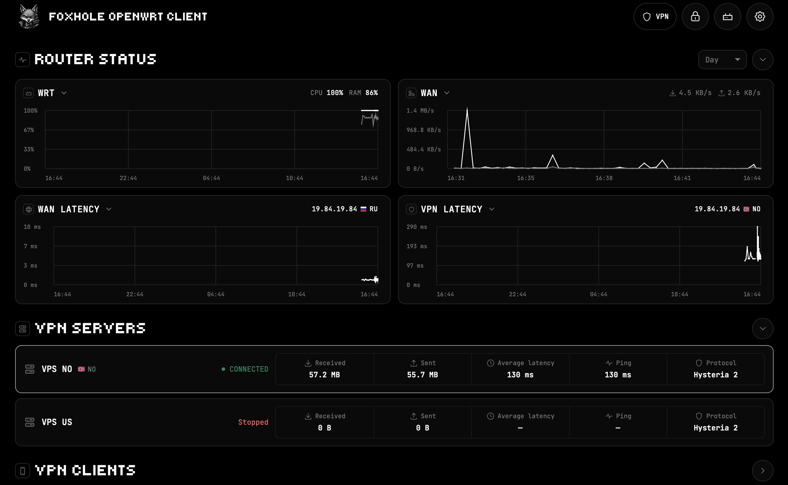

<h1 align="center">FoxHole OpenWrt</h1>

<div align="center">

Профили VPN, правила маршрутизации и простая панель для роутеров OpenWrt.
Исходящие подключения работают через [FoxHole Core](https://github.com/foxhole-team/foxhole-core).
В компактной установке каждому выбранному протоколу соответствует отдельный клиентский модуль. В версии 1.0.8 добавлен опциональный отдельно проверенный пакет входящего Hysteria2-сервера. Для удалённого доступа нужны публичный статический WAN-адрес и доступный извне UDP-порт.

</div>

<p align="center">
    
</p>

<div align="center">

[🇬🇧 English](../README.md) · [🇷🇺 **Русский**](README.ru.md) · [🇩🇪 Deutsch](README.de.md) · [🇫🇷 Français](README.fr.md) · [🇪🇸 Español](README.es.md) · [🇯🇵 日本語](README.ja.md) · [🇨🇳 简体中文](README.zh.md) · [🇸🇦 العربية](README.ar.md)

</div>

<p align="center">
  <a href="https://github.com/foxhole-team/foxhole-openwrt-client/releases">
    
  </a>
  
</p>

<a id="ecosystem"></a>
<a id="-экосистема-foxhole"></a>

<div align="center">
  <strong>FoxHole ecosystem</strong><br>
  <a href="https://github.com/foxhole-team/foxhole-guard">FoxHole Guard</a> ·
  <a href="https://github.com/foxhole-team/foxhole-vpn">FoxHole VPN</a> ·
  <a href="https://github.com/foxhole-team/foxhole-core">FoxHole Core</a> ·
  <a href="https://github.com/foxhole-team/foxhole-openwrt-client"><strong>FoxHole OpenWRT</strong></a> ·
  <a href="https://github.com/foxhole-team/foxhole-db">FoxHole DB</a>

<details>
<summary>Роли проектов</summary>

| Проект | Роль |
| --- | --- |
| [FoxHole Guard](https://github.com/foxhole-team/foxhole-guard) | Android: VPN, Tor/I2P, правила трафика и локальный мониторинг |
| [FoxHole VPN](https://github.com/foxhole-team/foxhole-vpn) | Android: простой VPN-клиент и управление сопряжённым OpenWrt |
| [FoxHole Core](https://github.com/foxhole-team/foxhole-core) | Общее сетевое ядро на Rust; состав зависит от сборки |
| [**FoxHole OpenWrt**](https://github.com/foxhole-team/foxhole-openwrt-client) | VPN для роутера и управление локальной сетью |
| [FoxHole DB](https://github.com/foxhole-team/foxhole-db) | Подписанные правила и справочные данные |

</details>

</div>

<p align="center"><a href="#quickstart">Начать</a> · <a href="#features">Возможности</a> · <a href="#details">Подробности</a> · <a href="#whats-new">Что нового</a></p>

<a id="whats-new"></a>

> **🆕 Что нового - 1.0.13 Beta (FLASH r1 · RAM r2)**
>
> - Установка по SSH с macOS, Linux и Windows через Bash. После первой настройки включается автообновление пакета, его можно отключить.
> - Обновление пакета проверяет API роутера и при сбое пытается восстановить прежнюю версию. Исправлены управление домашним VPN-сервером и создание первого клиента.
> - Поддерживаемые подписки Hysteria 2, VLESS и WireGuard можно импортировать в LuCI или переносить из Guard и VPN. Роутер обновляет их автоматически.
> - У пункта «Игры без VPN» в настройках обычный переключатель. Маршрутизация открывается из меню «Добавить». У стрелок раскрытия и сворачивания теперь чёткие углы.
> - В журнале новая иконка обновления, а в RAM видны последние десять событий VPN. В состоянии ПО отображается отдельно установленная Hysteria 2.

<a id="quickstart"></a>

## 📦 Установка

Это клиент для подключения к вашему VPN-серверу или провайдеру. Готовые VPN-серверы и доступ к ним в комплект не входят.

Выберите опубликованный проверенный выпуск. Замените `RELEASE_TAG` тегом выпуска, `MANIFEST_SHA256` - доверенным SHA-256 его `SHA256SUMS`, а `INSTALLER_SHA256` - SHA-256 `install.sh` именно этого выпуска. Подлинность значений подтвердите независимым способом. Установщик проверяется до запуска.

### С компьютера

Откройте исходники проверенного релиза на компьютере в локальной сети роутера. Установщик использует Bash и OpenSSH. В Windows нужен Git for Windows.

**macOS / Linux / Git Bash**

```sh
bash tools/foxhole-openwrt-install.sh --release RELEASE_TAG --manifest-sha256 MANIFEST_SHA256 --installer-sha256 INSTALLER_SHA256 --auto
```

**Windows PowerShell**

```powershell
& "$env:ProgramFiles\Git\bin\bash.exe" ./tools/foxhole-openwrt-install.sh --release RELEASE_TAG --manifest-sha256 MANIFEST_SHA256 --installer-sha256 INSTALLER_SHA256 --auto
```

Можно скачать `foxhole-openwrt-install.sh` из того же релиза, сверить SHA-256 с подписанным списком контрольных сумм и убрать `tools/` из команды. В примере PowerShell указан стандартный путь установки Git for Windows.

Установщик использует IPv4-адрес основного шлюза. Для выбора другого роутера в локальной сети добавьте `--host ROUTER_IP`. Сверьте ключ хоста SSH, войдите на роутер и прочитайте лицензионное соглашение.

### Из терминала роутера

Выполните команду на роутере от имени root.

```sh
( set -eu; release_tag='RELEASE_TAG'; manifest_sha256='MANIFEST_SHA256'; installer_sha256='INSTALLER_SHA256'; url="https://github.com/foxhole-team/foxhole-openwrt-client/releases/download/$release_tag"; installer=$(mktemp /tmp/foxhole-install.XXXXXX); trap 'rm -f "$installer"' EXIT; uclient-fetch -q -T 60 -O "$installer" "$url/install.sh"; printf '%s  %s\n' "$installer_sha256" "$installer" | sha256sum -c -; sh "$installer" --base-url "$url" --manifest-sha256 "$manifest_sha256" --apply )
```

При `--apply` интерактивный установщик показывает соглашение и спрашивает `[y/N]`; по умолчанию - отказ. Прочитать его можно командой `sh install.sh --license`. Неинтерактивная установка требует `--accept-license` после явного принятия условий. В мастере телефона отдельный флажок согласия изначально не отмечен.

Для компактного каталога по умолчанию устанавливается **только клиент Hysteria2**
во flash. Для проверенного локального набора можно выбрать один протокол или несколько:

```sh
sh install.sh --bundle /tmp/bundle --manifest-sha256 HASH --hy2 --flash --apply
sh install.sh --bundle /tmp/bundle --manifest-sha256 HASH --vless --wg --flash --apply
sh install.sh --bundle /tmp/bundle --manifest-sha256 HASH --hy2 --ram --apply
```

`-wg` - сокращение для `--wg`. Другие распознаваемые флаги: `--vmess`, `--tuic`,
`--trojan`, `--shadowsocks`, `--naive`, `--anytls`, `--shadowtls`, `--socks`, `--http`.
Каждый модуль должен быть опубликован для вашей прошивки и платформы. В компактном каталоге `--all` выбирает все доступные клиентские протоколы для этой платформы; они должны поддерживать общий режим хранения. Отдельно указанный протокол отклоняется, если его модуля нет. Для прежних каталогов schema 1 требуется точный вариант сборки; там `--all` означает все распознаваемые протоколы.

| Хранение | Поведение |
| --- | --- |
| `--flash` | Движок остаётся во flash после перезагрузки. По умолчанию. |
| `--ram` | Бинарник движка загружается в RAM и при необходимости повторно загружается после перезагрузки. Настройки остаются во flash. |
| `--auto` | Выбирает flash, если хватает ресурсов на полный набор, иначе доступный набор модулей RAM. |

Режим хранения `--ram` отличается от экспериментального native RAM bootstrap. Постоянное подключение bootstrap остаётся выключенным, восстановление после холодного старта не прошло квалификацию, а проблема допуска пользовательского ELF library path не устранена. Подробнее: [ограничения RAM bootstrap](RAM-BOOTSTRAP.md).

Без `--apply` выполняется проверка без установки. Пакеты ядра не обновляются ради несовместимой сборки. Для компактных каталогов `--server` доступен только при наличии подходящего проверенного пакета входящего Hysteria-сервера; только тогда сервер добавляется в бюджет ресурсов. Он остаётся выключенным до настройки удалённого доступа.

<a id="features"></a>

## 🔌 Поддерживаемые протоколы VPN

Текущие модули VPN FoxHole для роутера:

| Протокол | Параметр установки | Описание |
| --- | --- | --- |
| VLESS | `--vless` | Прокси-подключение к совместимому VLESS-серверу с параметрами, заданными в VPN-профиле. |
| Hysteria2 | `--hy2` | Подключение к Hysteria2-серверу через QUIC поверх UDP; используется отдельный клиентский модуль. |
| WireGuard | `--wg` | IP-туннель уровня L3 к узлу WireGuard; профиль задаёт ключи, адреса и сетевые параметры. |

## 📋 Требования

- OpenWrt 25.12.5 или 25.12.6 с пакетным менеджером apk и доступ root. Для прямой загрузки пакетов роутеру нужен Интернет; для локального `--bundle` достаточно доверенной LAN.
- Выпущенные пакеты для точной версии прошивки, платформы, архитектуры и выбранных протоколов. Текущая политика пакетов и обновлений допускает `x86/64` и `mediatek/filogic`; сборка SDK или название архитектуры ARM не подтверждают совместимость с каждой моделью роутера.
- Достаточно flash и RAM для полного проверенного набора пакетов. До изменения пакетов проверяются зависимости, ABI ядра и место для загрузки.
- Доступ из доверенной локальной сети. Для поиска и первоначальной настройки через Android подключите телефон к Wi-Fi роутера.

[Релиз v1.0.6](https://github.com/foxhole-team/foxhole-openwrt-client/releases/tag/v1.0.6) содержит BASE 1.0.6-r1 и клиентские модули FoxHole Core 1.0.4. Совместимые обновления Core можно устанавливать отдельно. Доступность пакетов и совместимость зависят от выбранного релиза, прошивки и target.

Поддержка в
исходниках и успешная кросс-компиляция сами по себе не подтверждают совместимость
с роутером. Устанавливаются только пакеты из подтверждённого каталога выпуска.
У входящего сервера остаются две проверенные находки в неиспользуемых пакетах
S2/OpenPGP; точные ограничения и срок исключений описаны в [проверках выпуска](RELEASE.md).

## Поддерживаемые роутеры

| Модель | RAM | Flash | OpenWrt | Установка пакета |
|---|---|---|---|---|
| [Cudy WR3000 v1](https://www.cudy.com/products/wr3000-1-0) | 256 МБ | 16 МБ NOR | 25.12.5 | Только RAM |
| [Cudy WR3000S v1](https://www.cudy.com/products/wr3000s-1-0) | 256 МБ | 128 МБ NAND | 25.12.6 | FLASH |

В таблице указана полная ёмкость памяти. Перед установкой мастер проверяет точную модель и свободное место.

<p align="center">
  
</p>

<a id="details"></a>

## 🔗 Работа и сопряжение

Смена PIN сбрасывает сопряжения: телефон потребуется подключить заново, при этом VPN-профили и настройки сохраняются.

Откройте **LuCI → Services → FoxHole OpenWRT Client → Panel**, задайте PIN и добавьте профиль VPN.
Правила направляют устройства, домены и трафик страны через VPN или напрямую.

`ACCESS_LOCAL_NETWORK` - поиск, настройка и управление роутером. На Android 17 (API 37) и новее, если приложение рассчитано на API 37 и новее, системное разрешение запрашивается до действий в LAN. Отказ блокирует эти действия.

Мастер телефона ищет роутер по частному IPv4-шлюзу подключённой сети Wi-Fi.
Адрес можно ввести вручную. Перед сопряжением проверяются SSH и TLS роутера; существующий
PIN сохраняется. Адрес управления остаётся частным.

Для создания удалённых VPN-клиентов нужен отдельный проверенный пакет входящего Hysteria-сервера. Его можно установить с `--server`, только если он есть в каталоге выбранного релиза. Также нужны публичный WAN-адрес и доступный извне UDP-порт. При выполнении этих условий действие **Создать VPN-профиль** добавляет удалённого клиента; выбор существующего клиента открывает его профиль.

Автоматическое переключение VPN телефона в домашней сети остаётся отключённым до реальной
проверки маршрутизации, владения туннелем и блокировки при отказе.


Отключение сопряжения убирает управление роутером. Для закрытия удалённого
VPN-доступа удалите клиента отдельно. Удаление старого общего профиля убирает
его запись и не отзывает пароль внешнего VPN-провайдера.

В приложениях Android:

Значок Wi-Fi показывает только физическое подключение, без SSID и доступа к геолокации. Поиск и новая настройка/сопряжение требуют Wi-Fi. В ручной ввод однократно подставляется частный IPv4-шлюз текущей сети Wi-Fi, если он доступен; адрес можно изменить.

«Управление через домашний VPN» - отдельный выбор, по умолчанию ВЫКЛЮЧЕННЫЙ для каждого существующего сопряжения. Также нужны ваша отметка «Публичный IP-адрес» (у роутера есть публичный IP и входящий VPN-сервис) и подходящий активный маршрут VPN. Эта отметка не назначает адрес и не настраивает firewall. Приложение может попытаться через эту VPN-сеть управлять сохранённым частным адресом с прежним закреплённым TLS-сертификатом и авторизацией сопряжения; WAN-порт управления не открывается, поиск и новое сопряжение через мобильную сеть не добавляются.

Отдельные метаданные связи с приложением получают только профили входящего VPN, переданные прямо в приложение аутентифицированным сопряжённым роутером. URI подключения, конфигурация и формат QR не меняются. Обычные web/QR-экспорты и профили провайдеров остаются без метки; импортированная подсказка сама по себе не создаёт доверие.

Автоматическое распознавание дополнительно требует совпадения сохранённого локального профиля, текущей конфигурации и выбранного сопряжения, причём этот профиль должен реально работать через VPN самого приложения. На фактическое подключение выполняется одна ограниченная проверка, без таймера, автоматических повторов и опроса профилей провайдеров. «Повторить сопряжение» - явный сценарий Wi-Fi/разрешения/PIN: старая запись сохраняется до успешной аутентификации, новый TLS-сертификат не принимается молча.

## Ограничения

- Правила стран используют IP-диапазоны, а доменные правила зависят от DNS роутера. Они не определяют страну владельца сайта и не анализируют содержимое HTTPS.
- Неожиданная потеря активного подключения Core включает блокировку его VPN-маршрутизации. Отдельная настройка Kill switch определяет блокировку без активного профиля и по умолчанию выключена.
- Приоритет правил, исключения для локальных адресов и ограничения входящего сервера описаны в [архитектуре](ARCHITECTURE.md).

## 🧩 Доустановка протоколов

Откройте **VPN роутера → Протоколы**, выберите доступный протокол и подтвердите
установку. Те же действия доступны в сопряжённом приложении Android.
Каждый протокол устанавливается отдельным компактным подписанным пакетом.
Недоступный вариант не подменяется универсальным движком.

Добавление неиспользуемого протокола не прерывает VPN. Обновление активного
протокола требует подтверждения переподключения. Используемый протокол нельзя
удалить. В списке доступны только выпущенные пакеты для вашей платформы.

## ♻️ Обновление и удаление

### 📥 Обновления пакетов FoxHole

В разделе **Настройки → Обновление FoxHole** веб-панели или сопряжённого приложения проверка и установка используют одну подтверждённую транзакцию. Обновляются панель/runtime FoxHole и выбранные установленные клиентские модули протоколов с сохранением режима FLASH/RAM. Новые протоколы устанавливаются отдельно. Профили и сопряжение сохраняются; прошивка OpenWrt и посторонние системные пакеты не обновляются.

При новой установке автообновление пакета включается после задания PIN владельца. Чтобы отключить его сразу, снимите галочку при настройке или передайте установщику `--no-auto-update`. Повторное сопряжение сохраняет прежний выбор. Позже его можно изменить в настройках.

Если включено, роутер ежедневно проверяет и устанавливает проверенные пакеты FoxHole. Отключение сопряжения телефона не выключает эту политику. Для старых пакетов без updater нужна отдельно проверенная миграция. Подробнее: [обновления ПО](UPDATES.md).

Добавляйте и обновляйте протоколы в разделе **VPN роутера → Протоколы** на
сопряжённом роутере или телефоне. Компактный установщик предназначен только для
первой установки. Он сохраняет закрытые резервные копии и проверяет, что DHCP не изменился.
Перед удалением пакетов при активной маршрутизации используйте
[инструкцию отката](ROLLBACK.md). Используйте проверенные пакеты выпуска.
Прежние установщики и отдельные ARM-загрузки не используются. Hysteria2 поддерживается FoxHole Core. Сохранённые legacy-профили используют отдельный движок Hysteria и не переводятся на Core автоматически. Перед обновлением активное legacy-подключение Hysteria нужно остановить вручную.

- **Инструкции:** [CLI](CLI.md) · [Updates](UPDATES.md) · [Rollback](ROLLBACK.md)
- **Архитектура:** [Architecture](ARCHITECTURE.md) · [Mobile networks](MOBILE-NETWORKS.md) · [Backup](BACKUP-ARCHITECTURE.md) · [Profile origin](PROFILE-ORIGIN.md)
- **Сопровождение:** [Release](RELEASE.md) · [Bundle transport](BUNDLE-TRANSPORT.md) · [RAM install](RAM-INSTALL.md) · [Bootstrap](RAM-BOOTSTRAP.md) · [Prerequisites](RAM-PREREQUISITES.md) · [RAM updates](RAM-UPDATE-CONTROLLER.md) · [Engine origin](engine-release-origin.md) · [Security](../SECURITY.md)

### Удаление FoxHole

В LuCI откройте **Службы → FoxHole OpenWRT Client → Uninstall FoxHole** и подтвердите удаление указанной установки. В терминале роутера от имени root выполните

```sh
/usr/libexec/foxhole-uninstall
```

Команда покажет план и запросит подтверждение. При удалении из FLASH отключится VPN и будет удалён основной пакет. При установке в managed RAM перезагрузите OpenWrt после отключения автозапуска. Если после перезагрузки останется копия во FLASH, удалите её отдельно. Сетевые настройки роутера, профили и сопряжения сохранятся. Кэш восстановления, ранее сохранённый во FLASH, остаётся на месте.

## Журнал диагностики

Во FLASH журнал хранит выбранные диагностические события до 30 дней. При заполнении буфера или уменьшении свободного места новые записи заменяют старые. Размер ограничен 1 МиБ и 2% доступного объёма с учётом файла журнала. Для системы остаётся не менее 1 МиБ или 10% файловой системы.

В RAM постоянный журнал отключён. Вместо него отображаются до десяти последних событий VPN с момента запуска роутера. Данные запрашиваются при открытии и обновляются каждые шесть секунд, пока журнал виден. [Устройство журнала](journal.md)

## 🤝 Участие в разработке

Сообщайте об ошибках и предлагайте изменения через [Issues](https://github.com/foxhole-team/foxhole-openwrt-client/issues).

## 💖 Поддержать разработку

Мы разрабатываем и поддерживаем FoxHole OpenWrt полностью за счёт собственного времени и ресурсов, с используя в разработке инструменты ИИ. Ваша поддержка помогает нам уделять проекту больше времени и ускорять разработку.

<a id="cryptocurrency-wallets"></a>

### 🪙 Криптовалютные кошельки

**XMR (Monero):**

```text
48yBVPTdcyJ1WoJtnKmVpEZziEsDy4HvbCW7eQDS9mfdiWPFXwZ8F5h9YZ2UTTBLxPcJgQgvth7iqLZM2yMCaQ432qaouqr
```

**BTC (Bitcoin):**

```text
bc1qatnyy7jcpqrp0d3dk9rta9vqfejgh4mysd6m2f
```

**ETH (Ethereum):**

```text
0xDEBA357Cc8f5E865ea7FFa98E138C8241A16A465
```

## 📄 Лицензии

[Лицензия](../LICENSE) · [Лицензии сторонних компонентов](../THIRD_PARTY_NOTICES.md)
